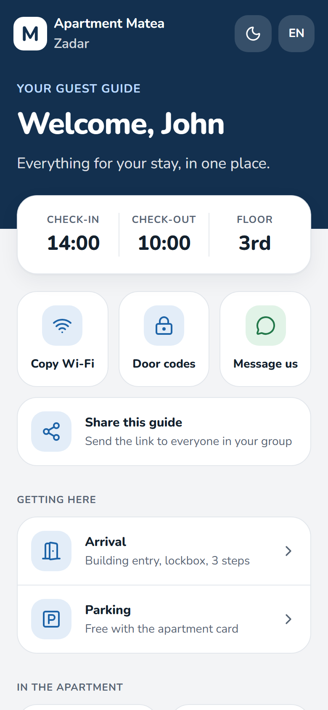
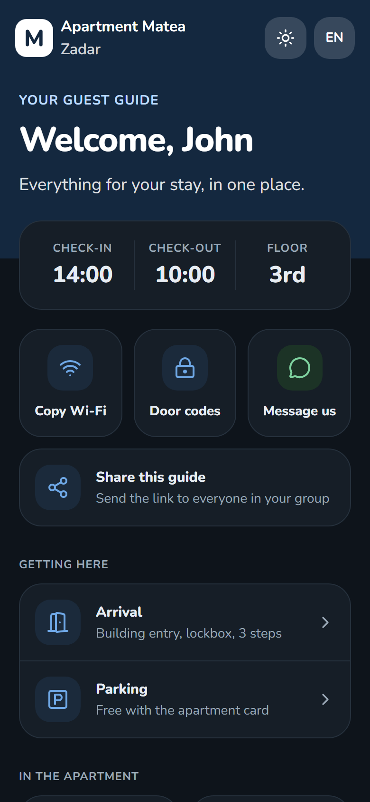
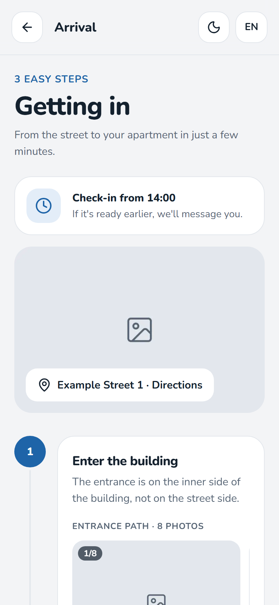
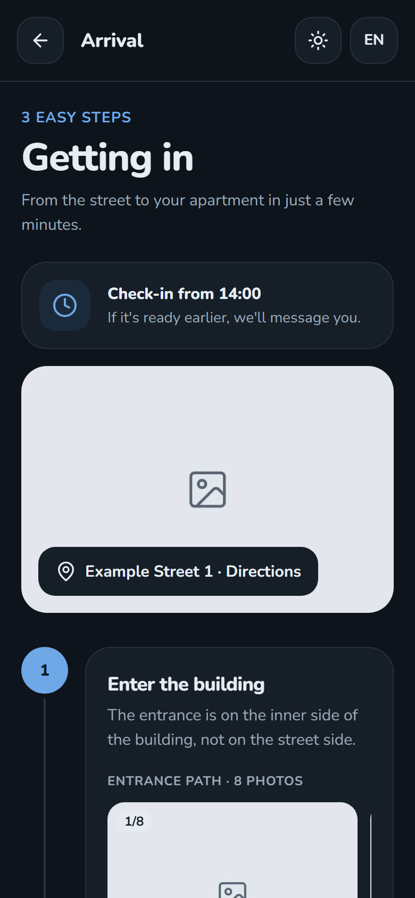
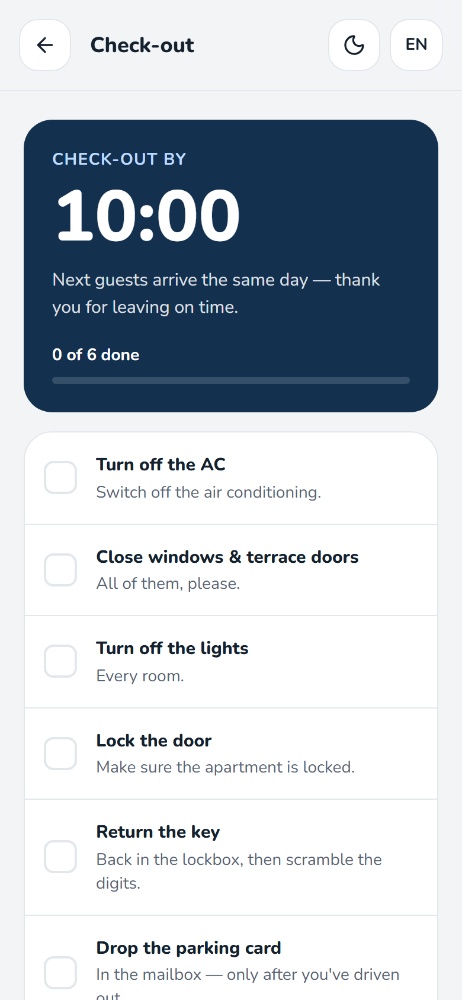
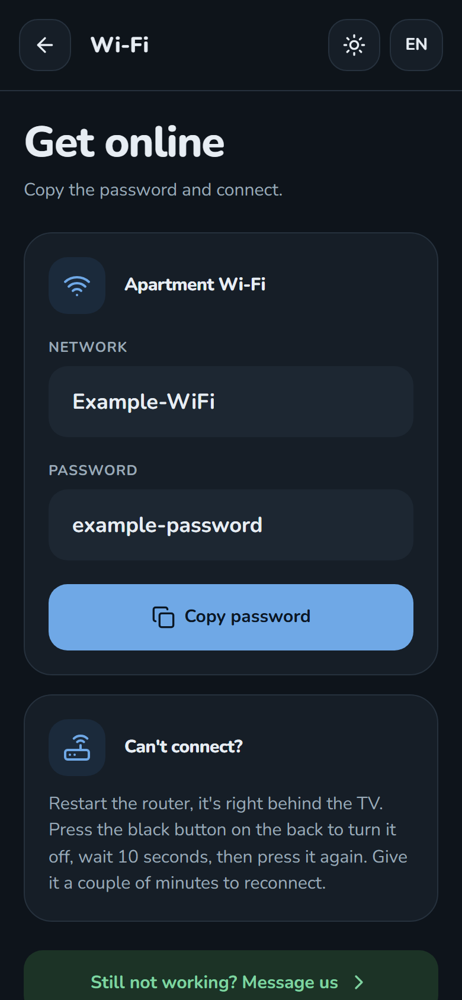
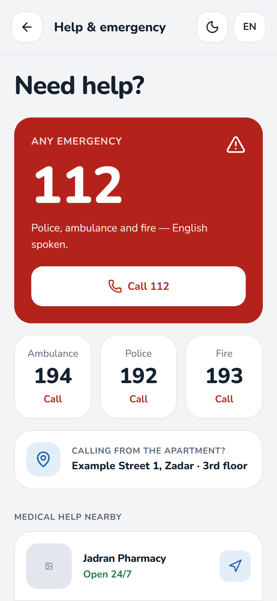
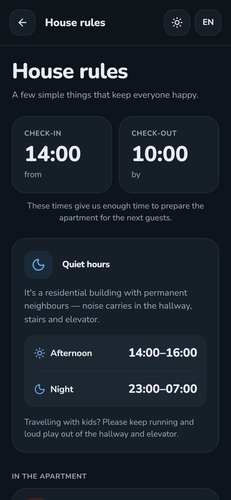

# Apartment Matea Guest Guide

A guest guide for my apartment in Zadar, with arrival instructions, parking
information, Wi-Fi details and apartment essentials.

This is the public version of the project. Wi-Fi details, door codes, the
address, parking details and most of the photos are replaced with placeholders.

## Live demo

[Open the demo guide](https://apartment-guest-demo.vercel.app/guide/641fb53929264c97bf8a29a811f10529)

The link includes a public demo token, so it opens straight into the guide.
Without a token, the site shows the no-access page.

## Screenshots

<p align="center">
  
  
  
  
</p>

<p align="center">
  
  
  
  
</p>

## Features

- Step-by-step arrival guide with photos and door codes
- Parking, Wi-Fi, TV, coffee maker and dishwasher instructions
- Check-out checklist with progress
- House rules, essentials finder and help & emergency contacts
- Explore Zadar: beaches, food and sights
- Photo lightbox and swipeable step carousels
- Dark mode that follows the system setting and remembers the guest's choice
- Private access with personal guest links, no account needed
- Thank-you page once a reservation is deactivated

## Guest access

Each reservation has its own random token. The guest opens
`/guide/<token>`, the server checks the token in the database and stores a
signed, HTTP-only cookie, then redirects to `/guide`. The token is
re-checked every 6 hours, so a deactivated reservation loses access
within that time.

- Active token → the guide
- Deactivated token → `/thank-you`
- Unknown token or no link → `/no-access`

## Planned

- Language switcher (the EN button in the header is a placeholder for now)

## Tech stack

- Next.js 16
- React 19
- TypeScript
- Tailwind CSS 4
- Neon (serverless Postgres)
- next-themes
- sonner
- lucide-react

## Project structure

```text
src/
├── app/
│   ├── guide/
│   │   ├── [token]/
│   │   ├── arrival/
│   │   ├── check-out/
│   │   ├── coffee/
│   │   ├── dishwasher/
│   │   ├── emergency/
│   │   ├── essentials/
│   │   ├── explore/
│   │   ├── house-rules/
│   │   ├── parking/
│   │   ├── tv/
│   │   ├── wifi/
│   │   └── page.tsx
│   ├── no-access/
│   ├── thank-you/
│   ├── apple-icon.png
│   ├── globals.css
│   ├── icon.svg
│   └── layout.tsx
├── assets/
├── components/
├── lib/
└── proxy.ts
public/
└── manuals/
docs/
└── screenshots/
```

## Development

Install dependencies:

```bash
npm install
```

Create a free [Neon](https://neon.tech) project and run this in its SQL Editor:

```sql
create table reservations (
  id serial primary key,
  token text not null unique default replace(gen_random_uuid()::text, '-', ''),
  guest_name text,
  language text not null default 'en',
  active boolean not null default true,
  created_at timestamptz not null default now()
);

insert into reservations (guest_name) values ('Ana') returning token;
```

Copy `.env.example` to `.env.local` and fill in your values.

Start the development server:

```bash
npm run dev
```

Open `http://localhost:3000/guide/<token>` with the token returned by the insert.
